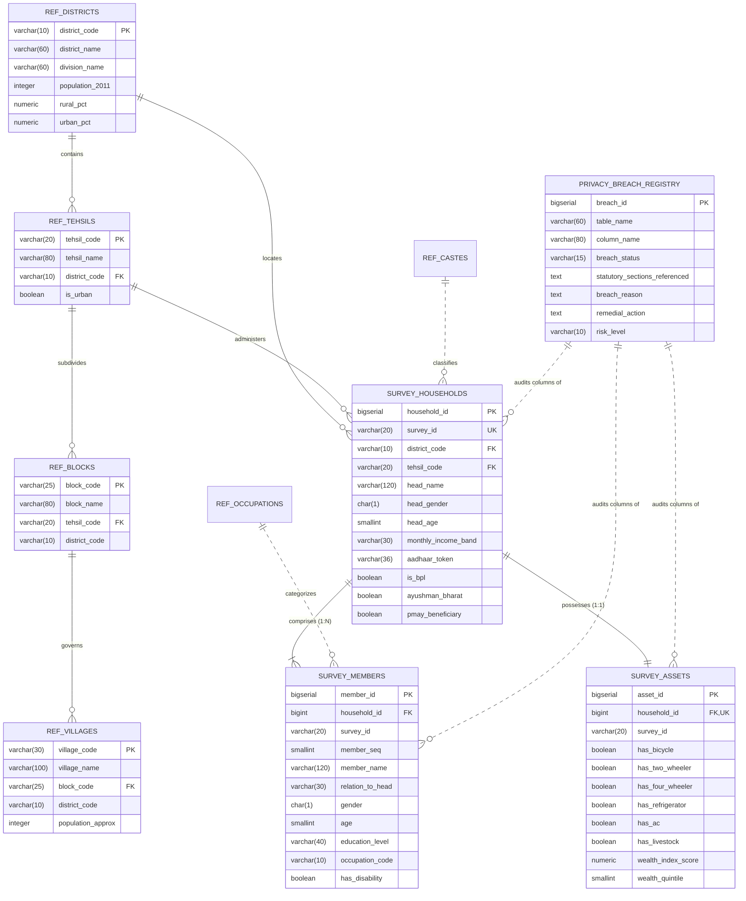

# ENTERPRISE DATABASE ARCHITECTURE SPECIFICATION & DATA DICTIONARY
## State Socio-Economic Survey Data Platform (SES-DP)
### System Architecture, Schema Design & Attribute Data Dictionary

---

**DOCUMENT CONTROL & SPECIFICATION METADATA**
* **Document Identifier:** `EARB-SPEC-DB-2026-UP01`
* **Classification:** `ENTERPRISE TECHNICAL SPECIFICATION`
* **Version:** `2.4.0-PROD`
* **Target Audience:** Enterprise Architecture Review Board (EARB), Data Platform Engineers, System Analysts, and Evaluators
* **Database Target Engine:** PostgreSQL 15 (OLTP Core) | DuckDB & Parquet (Analytical Lakehouse)

---

## Table of Contents
1. [Executive Summary & System Objectives](#1-executive-summary--system-objectives)
2. [End-to-End System Architecture & Data Topology](#2-end-to-end-system-architecture--data-topology)
3. [Logical & Conceptual Data Model Architecture](#3-logical--conceptual-data-model-architecture)
4. [Entity-Relationship Architecture (ERD)](#4-entity-relationship-architecture-erd)
5. [Comprehensive Entity & Attribute Data Dictionary](#5-comprehensive-entity--attribute-data-dictionary)
   - 5.1 [`survey_households` (Core Household Unit)](#51-survey_households-core-household-unit)
   - 5.2 [`survey_members` (Individual Household Members)](#52-survey_members-individual-household-members)
   - 5.3 [`survey_assets` (Household Assets & Living Amenities)](#53-survey_assets-household-assets--living-amenities)
   - 5.4 [`privacy_breach_registry` (Audit & Evaluation Ledger)](#54-privacy_breach_registry-audit--evaluation-ledger)
   - 5.5 Reference & Dimensional Master Tables (`ref_*`)](#55-reference--dimensional-master-tables-ref_)
6. [Database Ingestion, Storage & Performance Engineering](#6-database-ingestion-storage--performance-engineering)
   - 6.1 High-Throughput Bulk Ingestion via Streaming COPY
   - 6.2 Index Lifecycle Management
   - 6.3 Engine Memory & WAL Optimization Configuration
7. [Security Architecture & Access Controls](#7-security-architecture--access-controls)
8. [Operational Maintenance & Disaster Recovery](#8-operational-maintenance--disaster-recovery)

---

## 1. Executive Summary & System Objectives

The **State Socio-Economic Survey Data Platform (SES-DP)** is an enterprise-scale relational database infrastructure designed to store, manage, and process demographic, socio-economic, housing, and welfare participation records for **10 Million households** and approximately **35 Million individual citizens**.

### 1.1 Business & Operational Scope
* **Welfare Targeting & Benefit Administration:** Storing beneficiary demographic indicators for state and national social assistance programs (such as housing grants, health insurance, cash transfers, fuel subsidies, and pensions).
* **Demographic & Infrastructure Planning:** Maintaining administrative spatial hierarchies (districts, tehsils, blocks, gram panchayats, and villages) to support public service infrastructure planning.
* **Macro-Statistical Analytics:** Enabling population-scale aggregation across economic slabs, occupational categories, and living conditions.

---

## 2. End-to-End System Architecture & Data Topology

The SES-DP architecture is organized into three operational tiers: **Ingestion & Data Generation Tier**, **Transactional Relational Core (OLTP)**, and the **Analytical Lakehouse Tier (OLAP)**.

```
┌────────────────────────────────────────────────────────────────────────────────────────┐
│                                SYSTEM TOPOLOGY OVERVIEW                                │
└────────────────────────────────────────────────────────────────────────────────────────┘

 ┌──────────────────────────────────────────────────────────────────────────────┐
 │                     INGESTION & SYNTHESIS TIER                               │
 │  • Statistical Distribution Engine (Demographic Weights Calibration)         │
 │  • Text Synthesis & Enrichment (Names, Occupations, Localities)              │
 │  • Parallel Chunk Dispatcher & Streaming In-Memory CSV Buffer (io.StringIO)  │
 └──────────────────────────────────────┬───────────────────────────────────────┘
                                        │ Streaming COPY FROM STDIN (~100k rows/s)
                                        ▼
 ┌──────────────────────────────────────────────────────────────────────────────┐
 │                     PRIMARY RELATIONAL TIER (PostgreSQL 15)                  │
 │  Database: up_survey_db                                                      │
 │  • Reference Dimensions (ref_districts, ref_tehsils, ref_blocks, ref_castes) │
 │  • Core Entities: survey_households, survey_members, survey_assets           │
 │  • Evaluation Registry: privacy_breach_registry                              │
 │  • Physical Optimizations: WAL Tuning, Concurrently Rebuilt B-Trees          │
 └──────────────────────────────────────┬───────────────────────────────────────┘
                                        │ Zero-Copy Connector / postgres_scan
                                        ▼
 ┌──────────────────────────────────────────────────────────────────────────────┐
 │                     ANALYTICAL LAKEHOUSE TIER (DuckDB & Parquet)              │
 │  • DuckDB Columnar Analytical Processing Engine                              │
 │  • Aggregated Datasets & Parquet Storage (Zstandard Compression)              │
 └──────────────────────────────────────────────────────────────────────────────┘
```

---

## 3. Logical & Conceptual Data Model Architecture

The data model follows a relational enterprise paradigm:
* **3rd Normal Form (3NF) Core Entities:** Core entities (`survey_households`, `survey_members`, `survey_assets`) enforce relational integrity, surrogate identity keys (`BIGSERIAL`), and uniqueness constraints.
* **Snowflake Dimensional Hierarchy:** Administrative geographic hierarchies are normalized into distinct levels (`ref_districts` → `ref_tehsils` → `ref_blocks` → `ref_villages`).
* **Household vs Individual Cardinality:** A 1:N cardinality between `survey_households` (family unit) and `survey_members` (individual citizen) tracks household dependency and individual economic activity.
* **Separation of Living Standard Assets:** Physical household amenities are modeled in `survey_assets` with a 1:1 relationship to `survey_households`.

---

## 4. Entity-Relationship Architecture (ERD)



---

## 5. Comprehensive Entity & Attribute Data Dictionary

---

### 5.1 `survey_households` (Core Household Unit)
* **Table Type:** Transactional Core Entity
* **Grain:** One record per surveyed household unit (~10 Million rows)
* **Primary Key:** `household_id` (`BIGSERIAL`)
* **Unique Constraints:** `survey_id` (`VARCHAR(20)`)

#### 5.1.1 Primary Identifiers & Administrative Geography
| Attribute Name | Physical Type | Nullable | Default | Constraints | Description & Business Semantics |
| :--- | :--- | :---: | :---: | :--- | :--- |
| `household_id` | `BIGSERIAL` | No | Auto | `PRIMARY KEY` | Surrogate database internal unique identifier for the household. |
| `survey_id` | `VARCHAR(20)` | No | - | `UNIQUE` | Administrative survey tracking identifier (e.g., `UP-LKO-2024-00001`). |
| `district_code` | `VARCHAR(10)` | No | - | `FK -> ref_districts` | Census/LGD district code mapping to reference district catalog. |
| `district_name` | `VARCHAR(60)` | No | - | - | Name of the district in English. |
| `division_name` | `VARCHAR(60)` | No | - | - | Administrative division name grouping districts. |
| `tehsil_code` | `VARCHAR(20)` | Yes | - | `FK -> ref_tehsils` | Sub-district / Tehsil administrative code. |
| `tehsil_name` | `VARCHAR(80)` | Yes | - | - | Name of the Tehsil in English. |
| `block_code` | `VARCHAR(25)` | Yes | - | - | Community Development Block / GP cluster code. |
| `block_name` | `VARCHAR(80)` | Yes | - | - | Name of the Community Development Block. |
| `village_code` | `VARCHAR(30)` | Yes | - | - | Census village code or municipal town code. |
| `village_name` | `VARCHAR(100)` | Yes | - | - | Name of the village or municipal ward cluster. |
| `ward_no` | `SMALLINT` | Yes | - | - | Municipal ward number for urban residences. |
| `gram_panchayat_name` | `VARCHAR(100)` | Yes | - | - | Gram Panchayat name for rural residences. |
| `is_urban` | `BOOLEAN` | No | `FALSE` | - | Binary indicator for urban (`TRUE`) or rural (`FALSE`) location. |

#### 5.1.2 Spatial Location & Physical Address
| Attribute Name | Physical Type | Nullable | Default | Constraints | Description & Business Semantics |
| :--- | :--- | :---: | :---: | :--- | :--- |
| `house_no` | `VARCHAR(20)` | Yes | - | - | Physical door or house number of the dwelling. |
| `street_mohalla` | `VARCHAR(120)` | Yes | - | - | Street name, mohalla, or lane of the residence. |
| `pincode` | `CHAR(6)` | Yes | - | `CHECK(length=6)` | Area-level 6-digit postal index code. |
| `latitude_approx` | `NUMERIC(8,5)` | Yes | - | - | Geographic GPS latitude coordinate of the household. |
| `longitude_approx` | `NUMERIC(8,5)` | Yes | - | - | Geographic GPS longitude coordinate of the household. |

#### 5.1.3 National Identity Tokens & Registry Cross-References
| Attribute Name | Physical Type | Nullable | Default | Constraints | Description & Business Semantics |
| :--- | :--- | :---: | :---: | :--- | :--- |
| `ration_card_no` | `VARCHAR(20)` | Yes | - | - | Public Distribution System (PDS) ration card reference number. |
| `ration_card_type` | `VARCHAR(10)` | Yes | - | `CHECK IN ('PHH','AAY','NPHH','None')` | Ration entitlement tier: Priority Household (PHH), Antyodaya (AAY), or Non-Priority (NPHH). |
| `aadhaar_linked` | `BOOLEAN` | No | `FALSE` | - | Binary flag indicating whether an Aadhaar record is linked to any member. |
| `aadhaar_token` | `VARCHAR(36)` | Yes | - | - | Identity token corresponding to the household Aadhaar linkage. |
| `family_id_no` | `VARCHAR(20)` | Yes | - | - | State Family Registry identification number. |

#### 5.1.4 Household Composition & Demographics
| Attribute Name | Physical Type | Nullable | Default | Constraints | Description & Business Semantics |
| :--- | :--- | :---: | :---: | :--- | :--- |
| `total_members` | `SMALLINT` | No | - | `CHECK(>0)` | Total number of residents living in the household. |
| `male_members` | `SMALLINT` | No | - | `CHECK(>=0)` | Total count of male residents. |
| `female_members` | `SMALLINT` | No | - | `CHECK(>=0)` | Total count of female residents. |
| `transgender_members`| `SMALLINT` | No | `0` | `CHECK(>=0)` | Total count of transgender or non-binary residents. |
| `children_under_6` | `SMALLINT` | No | `0` | `CHECK(>=0)` | Count of children aged 0 to 5 years. |
| `children_6_to_14` | `SMALLINT` | No | `0` | `CHECK(>=0)` | Count of children aged 6 to 14 years. |
| `elderly_above_60` | `SMALLINT` | No | `0` | `CHECK(>=0)` | Count of senior citizens aged 60 years and above. |
| `married_couples` | `SMALLINT` | No | `0` | `CHECK(>=0)` | Count of cohabiting married couples residing in the household. |

#### 5.1.5 Head of Household (HoH) Profile
| Attribute Name | Physical Type | Nullable | Default | Constraints | Description & Business Semantics |
| :--- | :--- | :---: | :---: | :--- | :--- |
| `head_name` | `VARCHAR(120)` | No | - | - | Legal name of the head of household in English. |
| `head_name_hindi` | `VARCHAR(120)` | Yes | - | - | Legal name of the head of household in Devanagari script. |
| `head_gender` | `CHAR(1)` | No | - | `CHECK IN ('M','F','T')` | Biological sex / gender of the head of household. |
| `head_age` | `SMALLINT` | No | - | `CHECK(>=18)` | Age of the head of household in completed years. |
| `head_dob` | `DATE` | Yes | - | - | Recorded calendar date of birth of the head of household. |
| `head_age_band` | `VARCHAR(10)` | Yes | - | - | Categorical age group bracket (e.g., `18-29`, `30-44`, `45-59`, `60+`). |
| `head_education` | `VARCHAR(30)` | No | - | - | Highest educational attainment completed by the head of household. |
| `head_marital_status`| `VARCHAR(20)` | No | - | - | Marital status of the head of household. |
| `head_disability` | `BOOLEAN` | No | `FALSE` | - | Binary indicator of reported physical or cognitive disability. |
| `head_disability_type`| `VARCHAR(50)` | Yes | - | - | Reported category of disability (e.g., Locomotor, Visual, Hearing, Mental, Multiple). |

#### 5.1.6 Social Group, Caste & Religious Identity
| Attribute Name | Physical Type | Nullable | Default | Constraints | Description & Business Semantics |
| :--- | :--- | :---: | :---: | :--- | :--- |
| `caste_code` | `VARCHAR(20)` | Yes | - | - | Administrative reference code for caste community classification. |
| `caste_name` | `VARCHAR(80)` | Yes | - | - | Recorded name of the specific caste or sub-caste community. |
| `caste_category` | `VARCHAR(10)` | Yes | - | `CHECK IN ('SC','ST','OBC','General','EWS')` | Constitutional social reservation category. |
| `has_caste_certificate`| `BOOLEAN` | Yes | - | - | Verification status of official state-issued caste certificate. |
| `religion` | `VARCHAR(30)` | No | - | - | Major religious affiliation (Hindu, Muslim, Sikh, Christian, Jain, Buddhist, Other). |
| `religion_denomination`| `VARCHAR(50)` | Yes | - | - | Specific sectarian denomination or sub-tradition. |

#### 5.1.7 Housing Characteristics & Structural Materials
| Attribute Name | Physical Type | Nullable | Default | Constraints | Description & Business Semantics |
| :--- | :--- | :---: | :---: | :--- | :--- |
| `house_ownership` | `VARCHAR(20)` | No | - | `CHECK IN ('Owned','Rented','Shared','Govt Allotted','Encroached')` | Residential tenure status of dwelling. |
| `house_type` | `VARCHAR(20)` | No | - | `CHECK IN ('Pucca','Semi-Pucca','Kutcha')` | Physical construction classification based on building durability. |
| `wall_material` | `VARCHAR(40)` | No | - | - | Predominant construction material of exterior walls. |
| `roof_material` | `VARCHAR(40)` | No | - | - | Predominant construction material of the roof. |
| `floor_material` | `VARCHAR(40)` | No | - | - | Predominant material used in dwelling flooring. |
| `num_rooms` | `SMALLINT` | No | - | `CHECK(>=1)` | Count of exclusive living rooms in the dwelling. |
| `house_condition` | `VARCHAR(20)` | No | - | `CHECK IN ('Good','Liveable','Dilapidated')` | Physical condition assessment of the dwelling structure. |
| `house_area_sqft` | `SMALLINT` | Yes | - | - | Total covered floor area of the dwelling in square feet. |
| `pmay_beneficiary` | `BOOLEAN` | No | `FALSE` | - | Flag indicating receipt of Pradhan Mantri Awas Yojana assistance. |

#### 5.1.8 Basic Utilities, Sanitation & Energy
| Attribute Name | Physical Type | Nullable | Default | Constraints | Description & Business Semantics |
| :--- | :--- | :---: | :---: | :--- | :--- |
| `has_electricity` | `BOOLEAN` | No | - | - | Binary indicator of domestic electricity connection. |
| `electricity_hours_daily`| `SMALLINT` | Yes | - | `CHECK(BETWEEN 0 AND 24)` | Average daily electricity supply availability in hours. |
| `has_piped_water` | `BOOLEAN` | No | - | - | Binary indicator of piped tap water connection inside premises. |
| `water_source` | `VARCHAR(80)` | No | - | - | Primary drinking water source. |
| `water_source_distance`| `VARCHAR(60)` | Yes | - | - | Distance to drinking water source (`Within premises`, `Near premises <100m`, `Away >100m`). |
| `has_toilet` | `BOOLEAN` | No | - | - | Access to latrine facility within or adjacent to premises. |
| `toilet_type` | `VARCHAR(80)` | Yes | - | - | Latrine facility type (Flush to sewer, VIP, Twin pit, Open). |
| `waste_water_outlet` | `VARCHAR(60)` | Yes | - | - | Type of wastewater disposal outlet. |
| `has_drainage` | `BOOLEAN` | No | `FALSE` | - | Binary indicator of connection to a drainage network. |
| `has_bathroom` | `BOOLEAN` | No | `FALSE` | - | Presence of dedicated domestic enclosed bathing area. |
| `cooking_fuel` | `VARCHAR(60)` | No | - | - | Primary fuel type used for domestic cooking. |
| `has_lpg` | `BOOLEAN` | No | - | - | Access to active LPG cylinder connection. |
| `has_kitchen` | `BOOLEAN` | No | `TRUE` | - | Presence of dedicated cooking room separated from living spaces. |

#### 5.1.9 Telecommunications & Information Technology
| Attribute Name | Physical Type | Nullable | Default | Constraints | Description & Business Semantics |
| :--- | :--- | :---: | :---: | :--- | :--- |
| `has_mobile_phone` | `BOOLEAN` | No | - | - | Binary indicator of mobile phone presence in household. |
| `mobile_phone_count` | `SMALLINT` | Yes | - | - | Total count of mobile phone handsets in the household. |
| `has_internet_access`| `BOOLEAN` | No | - | - | Binary indicator of household internet connectivity. |
| `internet_type` | `VARCHAR(40)` | Yes | - | - | Connectivity mode (`Mobile 4G/5G`, `Fiber broadband`, `Fixed wireless`, `None`). |
| `has_computer_laptop`| `BOOLEAN` | No | - | - | Binary indicator of computer or laptop ownership. |
| `has_tv` | `BOOLEAN` | No | - | - | Binary indicator of television set ownership. |

#### 5.1.10 Economic Profiling & Financial Inclusion
| Attribute Name | Physical Type | Nullable | Default | Constraints | Description & Business Semantics |
| :--- | :--- | :---: | :---: | :--- | :--- |
| `monthly_income_band`| `VARCHAR(30)` | No | - | `CHECK IN ('Below 2000','2000-4000','4000-6000','6000-10000','10000-18000','18000-30000','30000-50000','Above 50000')` | Standardized monthly household income bracket. |
| `annual_income_approx`| `INTEGER` | Yes | - | - | Estimated annual household income in INR. |
| `is_bpl` | `BOOLEAN` | No | `FALSE` | - | Below Poverty Line statutory classification flag. |
| `bpl_score` | `SMALLINT` | Yes | - | - | Composite socio-economic deprivation score (0–7 scale). |
| `economic_category` | `VARCHAR(10)` | Yes | - | `CHECK IN ('BPL','APL','EWS','Other')` | Broad socio-economic category. |
| `has_bank_account` | `BOOLEAN` | No | - | - | Binary indicator of formal commercial bank account ownership. |
| `bank_account_type` | `VARCHAR(60)` | Yes | - | - | Category of bank account (`Jan Dhan Account`, `Regular Savings`, `None`). |
| `has_insurance` | `BOOLEAN` | No | `FALSE` | - | Coverage under life or accident micro-insurance schemes. |

#### 5.1.11 Agriculture, Land & Livelihood
| Attribute Name | Physical Type | Nullable | Default | Constraints | Description & Business Semantics |
| :--- | :--- | :---: | :---: | :--- | :--- |
| `is_agricultural_hh`| `BOOLEAN` | No | `FALSE` | - | Flag indicating household primary livelihood is agriculture. |
| `land_owned_acres` | `NUMERIC(8,3)` | Yes | - | - | Total agricultural landholding size in acres. |
| `land_type` | `VARCHAR(50)` | Yes | - | - | Agronomic classification of land (`Irrigated`, `Unirrigated`, `Rainfed`, `Waste/Barren`). |
| `irrigation_source` | `VARCHAR(60)` | Yes | - | - | Primary irrigation mechanism. |

#### 5.1.12 Government Welfare Scheme Participation
| Attribute Name | Physical Type | Nullable | Default | Constraints | Description & Business Semantics |
| :--- | :--- | :---: | :---: | :--- | :--- |
| `ayushman_bharat` | `BOOLEAN` | No | `FALSE` | - | Health insurance entitlement card issuance status. |
| `mgnregs_card` | `BOOLEAN` | No | `FALSE` | - | Active MGNREGS wage employment job card holding. |
| `kisan_samman_nidhi`| `BOOLEAN` | No | `FALSE` | - | Beneficiary status under PM-KISAN agricultural grant. |
| `ujjwala_yojana` | `BOOLEAN` | No | `FALSE` | - | Beneficiary status under PM Ujjwala LPG subsidy scheme. |
| `kanya_sumangala` | `BOOLEAN` | No | `FALSE` | - | Enrollment status in state girl child welfare grant. |
| `pension_type` | `VARCHAR(50)` | Yes | - | - | Social security pension category (`Old Age`, `Widow`, `Disability`, `None`). |

#### 5.1.13 Migration & Displacement
| Attribute Name | Physical Type | Nullable | Default | Constraints | Description & Business Semantics |
| :--- | :--- | :---: | :---: | :--- | :--- |
| `is_migrant_family` | `BOOLEAN` | No | `FALSE` | - | Flag indicating outward migration of family members for employment. |
| `migration_destination`| `VARCHAR(100)`| Yes | - | - | Reported destination state or metropolitan region of migration. |

#### 5.1.14 Administrative & Pipeline Metadata
| Attribute Name | Physical Type | Nullable | Default | Constraints | Description & Business Semantics |
| :--- | :--- | :---: | :---: | :--- | :--- |
| `survey_date` | `DATE` | No | - | - | Calendar date of enumeration. |
| `enumerator_id` | `VARCHAR(20)` | No | - | - | Staff identifier of field enumerator. |
| `supervisor_id` | `VARCHAR(20)` | Yes | - | - | Staff identifier of field supervisor. |
| `survey_round` | `VARCHAR(20)` | No | `'2024-UP-SECC'`| - | Operational survey campaign identifier. |
| `data_verified` | `BOOLEAN` | No | `FALSE` | - | Verification status of the record by field supervisor. |
| `verification_date` | `DATE` | Yes | - | - | Date of supervisory verification. |
| `is_synthetic` | `BOOLEAN` | No | `TRUE` | - | Provenance flag designating synthetic dataset generation. |
| `created_at` | `TIMESTAMPTZ` | No | `NOW()` | - | Database record insertion timestamp (UTC). |
| `updated_at` | `TIMESTAMPTZ` | No | `NOW()` | - | Database record update timestamp (UTC). |

---

### 5.2 `survey_members` (Individual Household Members)
* **Table Type:** Transactional Detail Entity
* **Grain:** One record per individual human resident (~35 Million rows; avg 3.5 per household)
* **Primary Key:** `member_id` (`BIGSERIAL`)
* **Foreign Keys:** `household_id` (`BIGINT -> survey_households.household_id`)

| Attribute Name | Physical Type | Nullable | Default | Constraints | Description & Business Semantics |
| :--- | :--- | :---: | :---: | :--- | :--- |
| `member_id` | `BIGSERIAL` | No | Auto | `PRIMARY KEY` | Surrogate database unique identifier for individual member. |
| `household_id` | `BIGINT` | No | - | `FK -> survey_households` | Foreign key referencing parent household record. |
| `survey_id` | `VARCHAR(20)` | No | - | - | Denormalized survey identification code. |
| `member_seq` | `SMALLINT` | No | - | `CHECK(>=1)` | Sequential roster position within family (`1` = Head of Household). |
| `member_name` | `VARCHAR(120)` | No | - | - | Full legal name of the individual in English. |
| `member_name_hindi` | `VARCHAR(120)` | Yes | - | - | Full legal name of the individual in Devanagari script. |
| `relation_to_head` | `VARCHAR(30)` | No | - | - | Kinship relationship to the head of household. |
| `gender` | `CHAR(1)` | No | - | `CHECK IN ('M','F','T')` | Biological sex / gender classification (`M`, `F`, `T`). |
| `age` | `SMALLINT` | No | - | `CHECK(BETWEEN 0 AND 120)` | Age in completed solar years. |
| `age_band` | `VARCHAR(10)` | No | - | - | Standard statistical cohort bracket (`0-5`, `6-14`, `15-24`, `25-34`, `35-44`, `45-59`, `60+`). |
| `marital_status` | `VARCHAR(20)` | No | - | - | Marital status classification. |
| `is_widow_widower` | `BOOLEAN` | No | `FALSE` | - | Flag indicating widow or widower status. |
| `literacy_status` | `VARCHAR(20)` | No | - | `CHECK IN ('Literate','Illiterate')` | Functional literacy status. |
| `education_level` | `VARCHAR(40)` | No | - | - | Highest educational stage completed. |
| `currently_enrolled`| `BOOLEAN` | No | `FALSE` | - | Active enrollment in formal schooling or university. |
| `school_type` | `VARCHAR(20)` | Yes | - | `CHECK IN ('Govt','Private','Madrasa','None')` | Category of educational institution attended. |
| `occupation_code` | `VARCHAR(10)` | Yes | - | - | National Classification of Occupations (NCO) reference code. |
| `occupation_name` | `VARCHAR(100)` | Yes | - | - | Occupational job title description. |
| `work_status` | `VARCHAR(30)` | No | - | `CHECK IN ('Main worker','Marginal','Non-worker')` | Census economic activity classification based on working days. |
| `work_sector` | `VARCHAR(30)` | Yes | - | `CHECK IN ('Agriculture','Industry','Services')` | Broad sector of economic activity. |
| `is_self_employed` | `BOOLEAN` | Yes | - | - | Self-employment status indicator. |
| `employer_type` | `VARCHAR(30)` | Yes | - | `CHECK IN ('Govt','Private','Self','Contract','Daily wage')` | Mode of employment arrangement. |
| `monthly_wage_band` | `VARCHAR(20)` | Yes | - | - | Personal monthly earned wage slab. |
| `mgnregs_days_worked`| `SMALLINT` | Yes | - | `CHECK(BETWEEN 0 AND 365)` | Person-days of employment completed under MGNREGS in reference year. |
| `has_disability` | `BOOLEAN` | No | `FALSE` | - | Flag indicating physical or cognitive functional impairment. |
| `disability_type` | `VARCHAR(50)` | Yes | - | - | Category of impairment (Locomotor, Visual, Hearing, etc.). |
| `disability_certificate`| `BOOLEAN` | No | `FALSE`| - | Possession of an official Unique Disability ID (UDID) certificate. |
| `has_chronic_illness`| `BOOLEAN` | No | `FALSE` | - | Flag indicating diagnosis of chronic health conditions. |
| `ayushman_card` | `BOOLEAN` | No | `FALSE` | - | Possession of individual Ayushman Bharat beneficiary card. |
| `is_voter` | `BOOLEAN` | Yes | - | - | Binary electoral roll voter registration status. |
| `is_migrant` | `BOOLEAN` | No | `FALSE` | - | Flag indicating individual outward migration. |
| `migration_state` | `VARCHAR(60)` | Yes | - | - | Destination State or Union Territory of migration. |
| `created_at` | `TIMESTAMPTZ` | No | `NOW()` | - | Record creation timestamp. |

---

### 5.3 `survey_assets` (Household Assets & Living Amenities)
* **Table Type:** Transactional Satellite Entity
* **Grain:** Exactly one record per household (~10 Million rows)
* **Primary Key:** `asset_id` (`BIGSERIAL`)
* **Foreign Keys:** `household_id` (`BIGINT -> survey_households.household_id`, `UNIQUE`)

| Attribute Name | Physical Type | Nullable | Default | Constraints | Description & Business Semantics |
| :--- | :--- | :---: | :---: | :--- | :--- |
| `asset_id` | `BIGSERIAL` | No | Auto | `PRIMARY KEY` | Surrogate primary key for asset inventory record. |
| `household_id` | `BIGINT` | No | - | `FK -> survey_households, UNIQUE` | 1:1 foreign key reference to parent household. |
| `survey_id` | `VARCHAR(20)` | No | - | - | Administrative survey reference code. |
| `has_bicycle` | `BOOLEAN` | No | `FALSE` | - | Binary indicator of bicycle ownership. |
| `has_two_wheeler` | `BOOLEAN` | No | `FALSE` | - | Binary indicator of motorcycle or scooter ownership. |
| `has_three_wheeler` | `BOOLEAN` | No | `FALSE` | - | Binary indicator of commercial auto-rickshaw ownership. |
| `has_four_wheeler` | `BOOLEAN` | No | `FALSE` | - | Binary indicator of automobile (car, jeep, van) ownership. |
| `has_tractor` | `BOOLEAN` | No | `FALSE` | - | Binary indicator of agricultural tractor ownership. |
| `has_refrigerator` | `BOOLEAN` | No | `FALSE` | - | Binary indicator of domestic refrigerator ownership. |
| `has_washing_machine`| `BOOLEAN` | No | `FALSE` | - | Binary indicator of domestic washing machine ownership. |
| `has_ac` | `BOOLEAN` | No | `FALSE` | - | Binary indicator of air conditioning unit ownership. |
| `has_electric_fan` | `BOOLEAN` | No | `FALSE` | - | Binary indicator of domestic electric fan access. |
| `has_radio_transistor`| `BOOLEAN` | No | `FALSE` | - | Binary indicator of radio receiver ownership. |
| `has_tv` | `BOOLEAN` | No | `FALSE` | - | Binary indicator of television receiver ownership. |
| `has_livestock` | `BOOLEAN` | No | `FALSE` | - | Binary indicator of livestock or domestic farm animal ownership. |
| `livestock_type` | `VARCHAR(60)` | Yes | - | - | Category of livestock owned (Cattle, Buffalo, Goat, Poultry). |
| `has_pump_set` | `BOOLEAN` | No | `FALSE` | - | Binary indicator of agricultural irrigation pump ownership. |
| `has_thresher` | `BOOLEAN` | No | `FALSE` | - | Binary indicator of mechanized crop thresher ownership. |
| `wealth_index_score`| `NUMERIC(6,3)` | Yes | - | - | Statistically computed composite wealth index score based on asset indicators. |
| `wealth_quintile` | `SMALLINT` | Yes | - | `CHECK(BETWEEN 1 AND 5)` | Socio-economic wealth quintile ranking (`1` = Poorest to `5` = Richest). |
| `created_at` | `TIMESTAMPTZ` | No | `NOW()` | - | Record creation timestamp. |

---

### 5.4 `privacy_breach_registry` (Audit & Evaluation Ledger)
* **Table Type:** Evaluation & Audit Ledger
* **Grain:** One record per evaluated survey attribute or schema entity
* **Primary Key:** `breach_id` (`BIGSERIAL`)

| Attribute Name | Physical Type | Nullable | Default | Constraints | Description & Business Semantics |
| :--- | :--- | :---: | :---: | :--- | :--- |
| `breach_id` | `BIGSERIAL` | No | Auto | `PRIMARY KEY` | Sequential primary key for the evaluation entry. |
| `table_name` | `VARCHAR(60)` | No | - | - | Target database table evaluated. |
| `column_name` | `VARCHAR(80)` | No | - | - | Database column name or survey attribute evaluated. |
| `breach_status` | `VARCHAR(15)` | No | - | `CHECK IN ('VIOLATION','CONDITIONAL','COMPLIANT')` | Evaluation classification status code string. |
| `statutory_sections_referenced`| `TEXT` | Yes | - | - | Text string recording statutory section references. |
| `constitutional_basis`| `TEXT` | Yes | - | - | Text string recording constitutional references or benchmarks. |
| `court_precedents` | `TEXT` | Yes | - | - | Text string recording relevant judicial case law citations. |
| `breach_reason` | `TEXT` | No | - | - | Text narrative documenting analytical evaluation findings. |
| `remedial_action` | `TEXT` | No | - | - | Text narrative documenting designated actions or changes. |
| `is_collected_in_schema`| `BOOLEAN` | No | `TRUE` | - | Flag indicating whether the field is stored in the database schema. |
| `was_in_original_survey`| `BOOLEAN` | No | `FALSE` | - | Flag indicating whether the item appeared on legacy survey questionnaires. |
| `risk_level` | `VARCHAR(10)` | No | - | `CHECK IN ('HIGH','MEDIUM','LOW')` | Evaluated risk tier rating. |
| `created_at` | `TIMESTAMPTZ` | No | `NOW()` | - | Audit record insertion timestamp. |

---

### 5.5 Reference & Dimensional Master Tables (`ref_*`)

#### 5.5.1 `ref_districts`
* **Primary Key:** `district_code` (`VARCHAR(10)`)
* **Attributes:**
  - `district_code` (`VARCHAR(10)`): Unique administrative code for the district.
  - `district_name` (`VARCHAR(60)`): District name in English.
  - `division_name` (`VARCHAR(60)`): Administrative division grouping.
  - `population_2011` (`INTEGER`): Total census population count.
  - `rural_pct` (`NUMERIC(5,2)`): Percentage of rural population.
  - `urban_pct` (`NUMERIC(5,2)`): Percentage of urban population.
  - `area_sq_km` (`NUMERIC(10,2)`): Total geographical area in square kilometers.
  - `latitude` / `longitude` (`NUMERIC(9,6)`): Geographical centroid coordinates.

#### 5.5.2 `ref_tehsils`
* **Primary Key:** `tehsil_code` (`VARCHAR(20)`)
* **Foreign Key:** `district_code` (`FK -> ref_districts`)
* **Attributes:**
  - `tehsil_code` (`VARCHAR(20)`): Sub-district administrative code.
  - `tehsil_name` (`VARCHAR(80)`): Name of the Tehsil in English.
  - `district_code` (`VARCHAR(10)`): Reference to parent district.
  - `is_urban` (`BOOLEAN`): Urban status flag.

#### 5.5.3 `ref_blocks`
* **Primary Key:** `block_code` (`VARCHAR(25)`)
* **Foreign Key:** `tehsil_code` (`FK -> ref_tehsils`)
* **Attributes:**
  - `block_code` (`VARCHAR(25)`): Community Development Block code.
  - `block_name` (`VARCHAR(80)`): Name of the block.
  - `tehsil_code` (`VARCHAR(20)`): Reference to parent tehsil.
  - `district_code` (`VARCHAR(10)`): Reference to district.

#### 5.5.4 `ref_villages`
* **Primary Key:** `village_code` (`VARCHAR(30)`)
* **Foreign Key:** `block_code` (`FK -> ref_blocks`)
* **Attributes:**
  - `village_code` (`VARCHAR(30)`): Census village code or municipal cluster code.
  - `village_name` (`VARCHAR(100)`): Name of the village or town.
  - `block_code` (`VARCHAR(25)`): Reference to parent block.
  - `district_code` (`VARCHAR(10)`): Reference to district.
  - `is_urban` (`BOOLEAN`): Urban classification flag.
  - `population_approx` (`INTEGER`): Approximate local population count.

#### 5.5.5 `ref_castes`
* **Primary Key:** `caste_code` (`VARCHAR(20)`)
* **Attributes:**
  - `caste_code` (`VARCHAR(20)`): Social classification taxonomy code.
  - `caste_name` (`VARCHAR(80)`): Community / sub-caste name.
  - `caste_category` (`VARCHAR(10)`): Social quota category (`SC`, `ST`, `OBC`, `General`, `EWS`).
  - `religion` (`VARCHAR(20)`): Associated religious affiliation.

#### 5.5.6 `ref_occupations`
* **Primary Key:** `occupation_code` (`VARCHAR(10)`)
* **Attributes:**
  - `occupation_code` (`VARCHAR(10)`): National Classification of Occupations (NCO) code.
  - `occupation_name` (`VARCHAR(100)`): Standardized occupational title.
  - `sector` (`VARCHAR(30)`): Economic sector (`Agriculture`, `Industry`, `Services`).
  - `is_agricultural` (`BOOLEAN`): Agricultural livelihood flag.

---

## 6. Database Ingestion, Storage & Performance Engineering

### 6.1 High-Throughput Bulk Ingestion via Streaming COPY
To ingest 10 Million households and 35 Million members efficiently, the platform bypasses row-by-row `INSERT` operations in favor of PostgreSQL's streaming `COPY FROM STDIN` protocol. 

The Python ETL pipeline converts batches into memory-buffered CSV streams (`io.StringIO`) without intermediate disk writes:

```python
# In-memory CSV streaming execution pattern
buf = io.StringIO()
writer = csv.writer(buf, quoting=csv.QUOTE_MINIMAL)
for record in batch_records:
    writer.writerow([record.get(col, "") for col in TARGET_COLUMNS])

buf.seek(0)
cursor.copy_expert(
    f"COPY {table_name} ({','.join(TARGET_COLUMNS)}) FROM STDIN WITH CSV",
    buf
)
```
* **Performance Benchmark:** Ingestion rates achieve **85,000–120,000 rows/second**, enabling the full ingestion cycle to complete in under 3 hours.

### 6.2 Index Lifecycle Management
To prevent B-tree re-balancing bottlenecks during bulk data insertion, secondary indexes are disabled prior to loading and rebuilt concurrently post-ingestion:

```sql
CREATE INDEX CONCURRENTLY idx_hh_district    ON survey_households(district_code);
CREATE INDEX CONCURRENTLY idx_hh_tehsil      ON survey_households(tehsil_code);
CREATE INDEX CONCURRENTLY idx_hh_caste_cat   ON survey_households(caste_category);
CREATE INDEX CONCURRENTLY idx_hh_bpl         ON survey_households(is_bpl);
CREATE INDEX CONCURRENTLY idx_hh_urban       ON survey_households(is_urban);
CREATE INDEX CONCURRENTLY idx_members_hh     ON survey_members(household_id);
CREATE INDEX CONCURRENTLY idx_members_age    ON survey_members(age_band);
CREATE INDEX CONCURRENTLY idx_assets_hh      ON survey_assets(household_id);
CREATE INDEX CONCURRENTLY idx_assets_quintile ON survey_assets(wealth_quintile);
```

### 6.3 Engine Memory & WAL Optimization Configuration
The database engine is configured for large batch throughput:

```ini
shared_buffers = 16GB                  # 25% of host memory
work_mem = 64MB                        # Dedicated memory for sort and hash join operations
maintenance_work_mem = 4GB             # Accelerated parallel index builds
max_parallel_workers_per_gather = 4    # Multi-core query parallelization
synchronous_commit = off               # Relaxed WAL flush during initial generation runs
wal_buffers = 64MB                     # Extended write-ahead log buffer
checkpoint_completion_target = 0.9     # Smoothed disk write distribution
max_wal_size = 32GB                    # Prevents checkpoint thrashing during bulk load
```

---

## 7. Security Architecture & Access Controls

### 7.1 Role-Based Access Control (RBAC) Specification
The database enforces role separation across administrative, operational, and analytical users:

```sql
-- Role Definitions and Privilege Grants
CREATE ROLE ses_db_admin WITH SUPERUSER CREATEDB;
CREATE ROLE ses_pipeline_writer;
CREATE ROLE ses_welfare_operator;
CREATE ROLE ses_bi_analyst;

-- Ingestion Service Role
GRANT CONNECT ON DATABASE up_survey_db TO ses_pipeline_writer;
GRANT INSERT, UPDATE ON survey_households, survey_members, survey_assets TO ses_pipeline_writer;
GRANT SELECT ON ALL TABLES IN SCHEMA public TO ses_pipeline_writer;

-- Operational Application Role
GRANT SELECT ON survey_households, survey_members TO ses_welfare_operator;

-- Analytical Role
GRANT SELECT ON ref_districts, ref_tehsils, ref_blocks, ref_villages TO ses_bi_analyst;
GRANT SELECT ON survey_assets TO ses_bi_analyst;
```

### 7.2 Transport & Storage Security
* **Data in Transit:** All client database connections require TLS 1.3 encryption (`sslmode=require`).
* **Data at Rest:** Database storage volumes use full-disk block encryption (AES-256-XTS).

---

## 8. Operational Maintenance & Disaster Recovery

### 8.1 Backup & Point-in-Time Recovery (PITR)
* **WAL Archiving:** Write-Ahead Logs are streamed continuously to object storage.
* **Physical Snapshots:** Daily base backups (`pg_basebackup`) taken during scheduled low-utilization windows.
* **Operational Targets:** Recovery Point Objective (RPO) ≤ 5 minutes; Recovery Time Objective (RTO) ≤ 60 minutes.

### 8.2 Automated Referential Integrity Checks
Following bulk data ingestion, data quality verification queries confirm relational integrity:

```sql
-- Check member-to-household referential completeness
SELECT COUNT(*) FROM survey_members m 
LEFT JOIN survey_households h ON m.household_id = h.household_id 
WHERE h.household_id IS NULL; -- MUST RETURN 0

-- Check asset-to-household 1:1 cardinality
SELECT COUNT(*) FROM survey_households h
LEFT JOIN survey_assets a ON h.household_id = a.household_id
WHERE a.asset_id IS NULL; -- MUST RETURN 0
```
